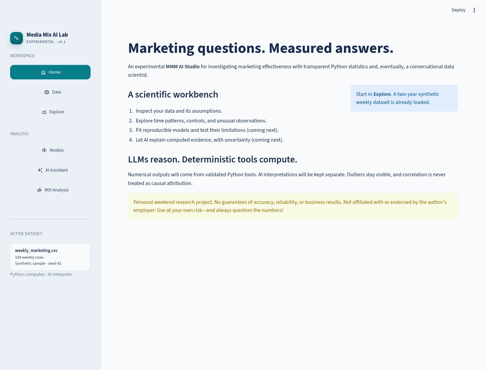
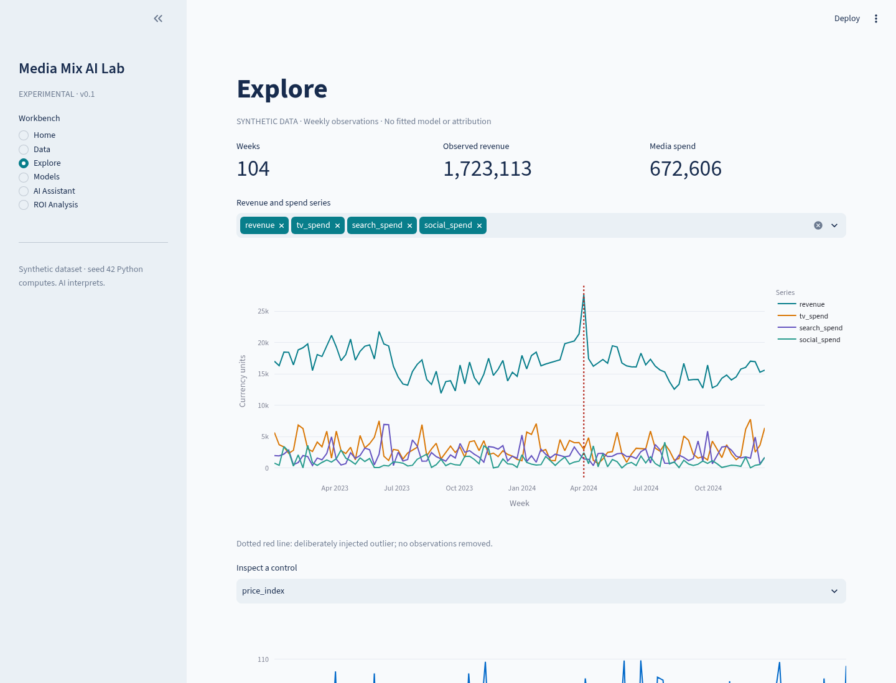
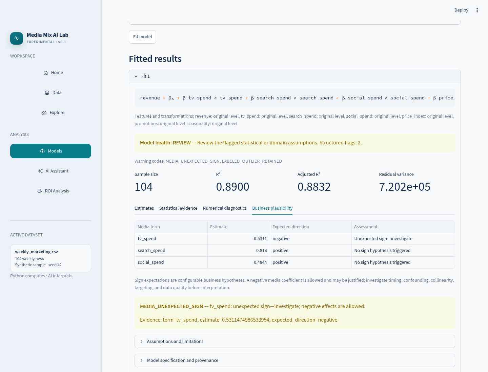
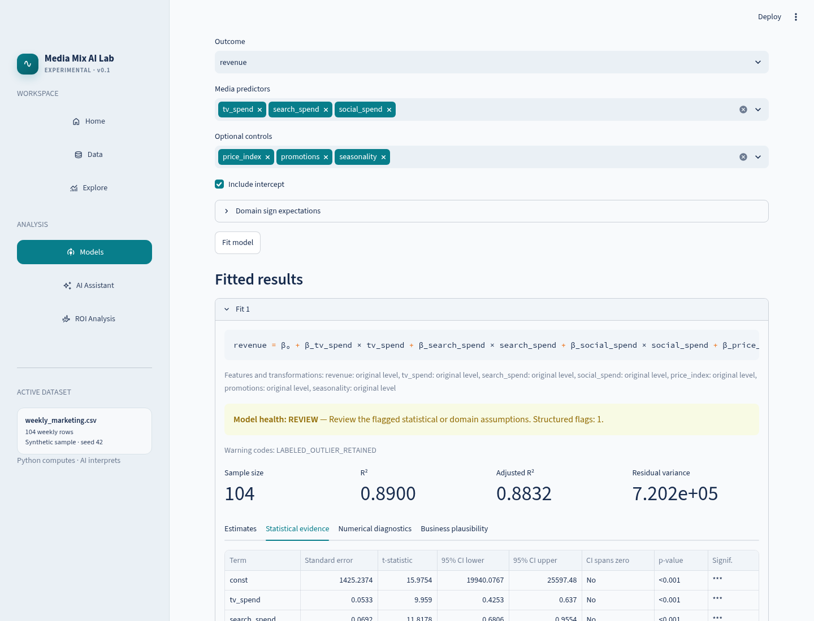
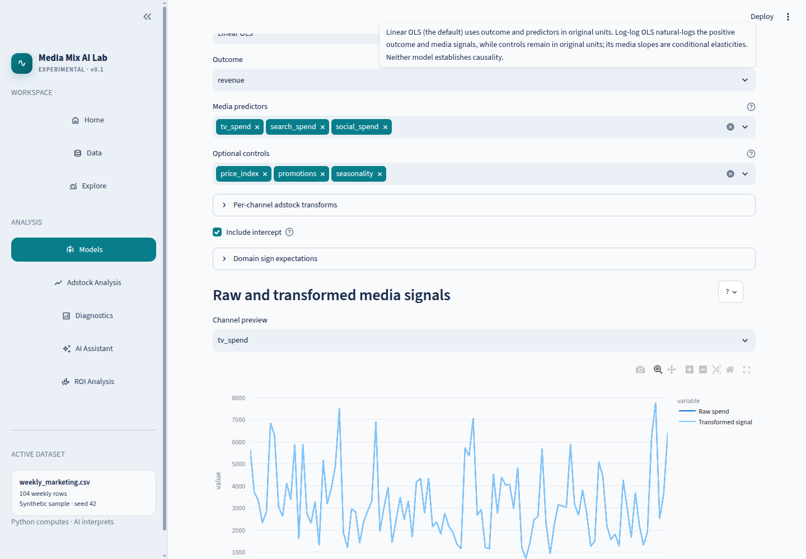
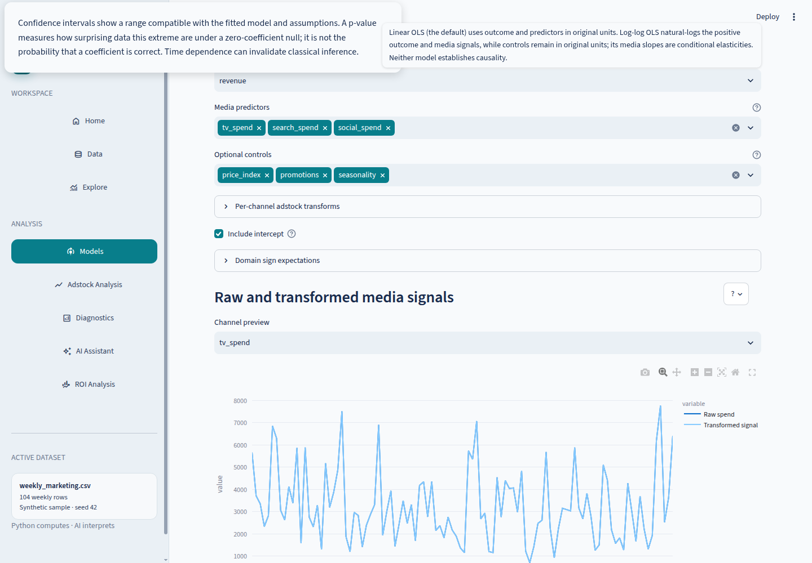
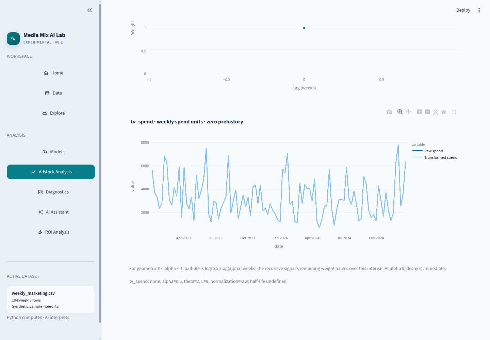
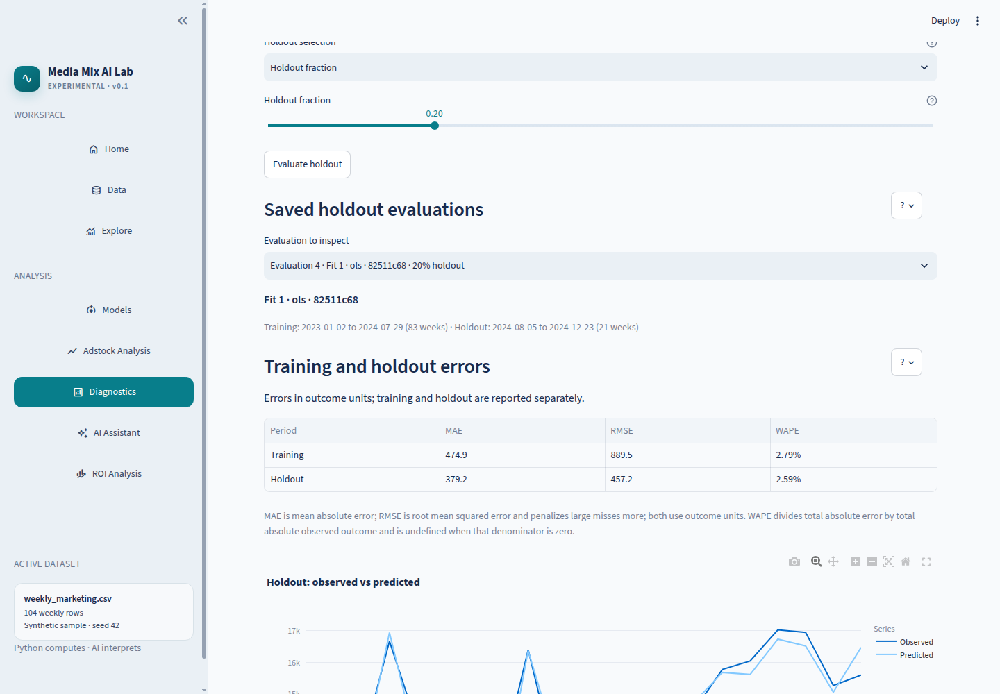

# Media Mix AI Lab

This repo contains an **MMM AI Studio**: an experimental, AI-assisted Media Mix Modeling playground built with Python.
It combines statistical models, interactive visualizations, and conversational AI to explore marketing effectiveness, investigate outliers, identify potential hidden variables, and estimate advertising ROI.
The idea is simple: let AI do some of the thinking, let deterministic Python tools do the math, and see how far we can get before statistics reminds us that correlation isn't causation.

**Disclaimer:** This is a personal weekend project, built to explore what's possible with AI-assisted data science. No guarantees of accuracy, reliability, or business results. Not affiliated with or endorsed by my employer. Use at your own risk—and always question the numbers!

## Multi-agent experimentation

This project also serves as a personal experiment in **AI-assisted software development across multiple agents, LLMs, and agentic coding tools**. The goal is to compare how different configurations approach product planning, implementation, testing, code review, and scientific reasoning—not to endorse any single model or tool.

Experiments may involve different model families (for example, **Astra**) and different agentic workflows or development tools. Their contributions and outcomes should be documented as they are actually tested; mentioning a model or tool here does not imply that it has already been used or validated in this repository.

## Status and stack

The foundation is a working Streamlit workbench with synthetic data exploration,
an in-session weekly CSV workspace, and transparent linear/log-log OLS fitting
with explicit observation accounting. AI conversations and ROI estimation are
not implemented. No credentials, external services, or paid APIs are required.

Python **3.12**, Streamlit, Plotly, Pandas, NumPy, Statsmodels, SciPy,
Scikit-learn, and Pydantic form the application stack. **uv** manages dependencies
with a committed lockfile; **Pytest** and **Ruff** cover tests and linting.

## Local development

Install [uv](https://docs.astral.sh/uv/getting-started/installation/), then run
these commands from the repository root:

```sh
uv python install 3.12
uv sync --locked
uv run streamlit run app.py
```

`uv sync` also works; `--locked` ensures dependency declarations match `uv.lock`.
The app starts on Home with a sample already loaded. Choose **Explore** in the
sidebar to inspect weekly revenue, channel spend, and controls using interactive
Plotly charts. **Data** shows the complete table, offers a CSV download, and
accepts a weekly CSV with explicit date, target, channel, and optional control
mapping. The **Models** section shows pre-fit eligibility and log-domain checks,
fits OLS or strict log-log OLS, and lets you download each fit with its
observation accounting, specification, diagnostics, and provenance as JSON.
The separate **Diagnostics** page evaluates a saved model specification using
either a chronological holdout fraction or a date cutoff; it never shuffles or
sorts rows. Inspect MAE, RMSE, WAPE, observed-versus-predicted outcomes, residuals
over time, residual autocorrelation, and training-design collinearity. Two saved
evaluations can be compared; differing holdout dates are flagged. Stored
specifications are re-evaluated against the currently loaded dataset, not their
original fit data.

```sh
uv run pytest
uv run ruff check .
uv run ruff format --check .
```

CI runs the locked install, lint, formatting check, and tests on Python 3.12.
Tests exercise data reproducibility, schema errors, preservation of inputs,
configuration validation, OLS coefficient recovery, observation accounting and
error cases, typed summary tools, and all seven Streamlit sections.

## Architecture

```text
app.py                         Streamlit entry point
src/media_mix_ai_lab/
  ui/                          Presentation and navigation
  data/                        Deterministic generation and nonmutating validation
  core/                        Serializable Pydantic model specifications
  modeling/                    OLS engine, future engine protocol, and result contract
  diagnostics/                 Coefficient, model-health, and temporal diagnostics
  optimization/                Reserved for response curves and budget optimization
  ai/                          Provider-neutral conversation and typed tool contracts
tests/                         Unit and Streamlit AppTest smoke tests
data/samples/                  Public synthetic CSV and its provenance
.streamlit/config.toml         Theme and server defaults
.github/workflows/ci.yml        Reproducible quality checks
```

## How OLS fitting works

The **Adstock Analysis** page lets you explore theoretical lag weights and compare
raw with transformed weekly spend. Its search runs only when requested. It uses
chronological fit, validation, and final-test periods (60/20/20 by default),
ranks a bounded candidate grid by validation RMSE, and leaves final-test outcomes
unread until the analyst explicitly freezes the selection and evaluates it once.
Further searches on that dataset are then locked. The downloadable manifest records candidates, errors,
partitions, transforms, and software versions. All transforms use zero
prehistory and observed past spend across partition boundaries; no warm-up rows
are removed. Log-target predictions use `exp(predicted log outcome)` without a
smearing correction, so level-scale errors may be biased. This is predictive
parameter selection, not evidence of causal advertising effects; coefficient
p-values after selection are optimistic.

On **Models**, choose the outcome, mapped media predictors, optional controls,
model family, and whether to include an intercept. Linear OLS fits
`outcome = intercept + Σ(media coefficient × media) + Σ(control coefficient × control) + error`
using each selected column in its original units. Statsmodels estimates the
coefficients by minimizing the sum of squared residuals. The optional intercept
is included as a constant design-matrix column; when omitted, R² follows
statsmodels' uncentered convention.

Strict log-log OLS instead fits
`log(outcome) = intercept + Σ(media coefficient × log(media)) + Σ(control coefficient × control) + error`.
Natural logarithms are applied only to the outcome and selected media columns.
Controls remain in their original units. The outcome and every logged media
observation must be strictly positive; a fit rejects nonpositive values with
counts and row/date examples. It never uses `log1p`, adds an epsilon, or drops
observations. The selected outcome and predictors must also be numeric, finite,
and nonmissing. Exact rank deficiency and designs without residual degrees of
freedom are rejected rather than returning unidentified coefficients.

On **Models**, each selected media channel can independently use no adstock,
recursive geometric adstock, or delayed geometric adstock. None is the identity.
Geometric adstock uses `a[t] = x[t] + alpha × a[t-1]`, with `0 ≤ alpha < 1`,
an explicit initial state defaulting to zero, and no finite truncation. For
`0 < alpha < 1`, its displayed half-life is `log(0.5) / log(alpha)`. Delayed
geometric adstock uses `w[l] = alpha^((l-theta)^2)` for lags `0..L`, then
`a[t] = Σ w[l] × x[t-l]`; `0 < alpha < 1`, `0 ≤ theta ≤ L`, and the suggested
initial values are `alpha=0.7`, `theta=2`, and `L=8` weeks. Missing prior
history is zero; optional delayed-adstock history is entered oldest to newest.
Weights are raw by default; `sum_to_one` is an explicit, persisted alternative.
Geometric history is recursive (not truncated), while delayed geometric uses
the displayed finite lag window. Adstock requires ordered, unique weekly dates
with no missing weeks, and negative media spend is rejected. The preview shows
raw and transformed signals, early-window behavior, and the corresponding
impulse response. The model result retains all per-channel settings, and its
dataset hash is based on the unchanged source data.

Before fitting, the workbench reports total and eligible observations,
nonpositive values by logged variable, and the unique affected source rows. A
successful result records input, fitted, and excluded counts plus one explicit
transformation policy. Under the current strict policy, every successful fit
uses every input row: `sample_size == n_fitted` and `n_excluded == 0`.

The result separates coefficient estimates and units, classical statistical
evidence, numerical diagnostics, and business-plausibility hypotheses. Each term
shows its standard error, t-statistic, 95% confidence interval, whether the
interval spans zero, its classical two-sided t-test p-value, an R-style
significance code, and a deterministic noncausal interpretation. The engine uses
the fitted Statsmodels `tvalues` and `pvalues` directly and retains their full
numeric precision in JSON; the UI displays very small p-values as `<0.001`.
Significance codes use the familiar
`***` p ≤ 0.001, `**` p ≤ 0.01, `*` p ≤ 0.05, and `.` p ≤ 0.10 thresholds.
They summarize evidence for H₀: coefficient = 0, conditional on the selected
model and the displayed classical OLS assumptions. Time-series dependence and
multiple testing can make them misleading. Stars do not measure effect size or
turn an association into a causal result.

Media terms default to an expected positive direction, configurable per channel
as positive, negative, or either sign. A conflicting estimate is labelled
`MEDIA_UNEXPECTED_SIGN` and “unexpected sign—investigate”; it remains a valid
estimate rather than a mathematical error. The basic assessment also flags
intervals spanning zero, large standard errors relative to estimates, low
residual degrees of freedom, poor conditioning, no-intercept R² conventions, and
retained labelled outliers. Exact singularity and undefined log inputs remain
hard model-specification errors. A nonfinite fitted output is rejected with the
explicit `NONFINITE_ESTIMATE` numerical-violation code instead of being written
as misleading or invalid JSON.

Every flag has a stable code, category, severity, and supporting evidence. The
model-health status and thresholds are deterministic and included in the JSON
download alongside sample size, R², adjusted R², residual variance, fitted
equation, transformations, configuration, dataset fingerprint, and package
versions. “Healthy” only means that these limited checks did not fire; it does
not validate causal identification or all OLS assumptions. Fits are retained in
the current Streamlit session. See the committed
[negative-media result export](docs/examples/negative-media-result.json) for the
complete machine-readable shape and supporting evidence.

## Temporal validation and diagnostic limitations

The **Diagnostics** page splits the already ordered weekly observations by a
fraction or a user-selected cutoff date. It rejects nonweekly, unordered, or
empty partitions and never shuffles, sorts, imputes, or drops observations.
OLS coefficients are fitted using training rows only. The current model has no
learned scaler or imputer: log transforms are deterministic, and adstock for a
holdout week uses only current and prior media values, including available
training history. Changing future rows cannot change training coefficients or
training metrics.

MAE and RMSE are reported in the original target units. WAPE is
`sum(abs(actual - predicted)) / sum(abs(actual))`; it is undefined when the
denominator is zero. For log-log OLS, the exponentiated log prediction is on the
target's original scale but represents a conditional geometric-scale estimate,
not a bias-corrected arithmetic mean. Training errors are shown separately from
holdout errors. R² and adjusted R² are undefined when the fitted outcome is
constant and are displayed as unavailable.

Durbin–Watson and Ljung–Box are calculated on holdout residuals; they describe
residual serial correlation, not causality or model correctness. Ljung–Box is
omitted for fewer than eight residuals, and constant residuals make both
autocorrelation diagnostics undefined. VIF and the condition number use the
training design only. VIF can be unreliable for small samples; condition numbers
depend on predictor units and scaling. These are screening indicators, not
automatic model-selection rules. Comparisons warn when saved evaluations cover
different holdout dates. A failed model fit is reported rather than silently
skipped.

## Statistical assumptions and limitations

These are unweighted, in-sample OLS estimates of conditional associations, not
causal effects. The model assumes the conditional mean is correctly specified
and linear in its coefficients. Classical standard errors and confidence
intervals rely on independent, homoskedastic errors (and normal errors for
exact finite-sample t inference); weekly autocorrelation, heteroskedasticity,
omitted confounders, or influential observations can make inference misleading.
The app does not compute robust or autocorrelation-adjusted standard errors.

Linear-model coefficients are changes in outcome units per one-unit change in
the corresponding predictor, conditional on the other selected terms. In
log-log models, media slopes are conditional elasticities: approximately the
percent change in outcome for a one-percent change in that media predictor,
holding other terms fixed. They are not ROI or causal lift. Level-control
coefficients in a log-log model are not elasticities: the displayed finite
one-unit change is converted with `100 × expm1(coefficient)`, which is the
model-implied percentage change rather than the small-change approximation
`100 × coefficient`. No rows are silently cleaned or removed. Adstock is a
deterministic signal transform, temporal validation measures predictive
generalization, and response curves are not causal attribution. Numerical
results remain separate from AI interpretations.
The allowlisted AI-facing tool computes descriptive statistics directly from
validated data; no remote provider, autonomous dispatcher, or generated code
execution exists.

Outliers are never silently removed; validation rejects invalid inputs without
cleaning or mutating them. Correlation is not causal attribution, and observed
revenue/spend must not be presented as incremental advertising ROI.

## Uploaded weekly datasets

On **Data**, upload a UTF-8 CSV with a header row, select its date and numeric
target columns, map at least one numeric channel, and optionally map numeric
controls. Dates must be valid, unique, ascending, and exactly seven days apart;
the selected frequency is weekly. The upload must already be in weekly order:
the app does not sort or fill gaps. Numeric missing values are retained and
reported, and appear as chart gaps; zero values are counted but are not treated
as missing. Infinite values and nonnumeric mapped columns are rejected. No
imputation, row removal, or other cleaning is performed.

The data page reports each source column's mapped role, missing count, and zero
count. Provenance displays the uploaded filename, row and column counts, mapping,
and SHA-256 of the original CSV bytes. Uploaded data remains in the current
Streamlit session and is not sent to an external service or persisted by the app.
The download contains the current table, with the selected date column parsed as
dates. Daily/monthly frequencies, user-selected cleaning, and persistent
datasets are outside this workspace's scope.

## Synthetic data

The included sample has 104 weekly observations from January 2023, with arbitrary
currency-unit revenue, TV/Search/Social spend, price index, binary promotions,
and annual seasonality. Combined weekly media investment is capped at **10,000**
units, with modest synthetic channel returns. NumPy seed **42** makes it
reproducible. A deliberately injected 8,000-unit revenue spike at row 65
(zero-based) is explicitly labelled and retained. The data is synthetic and
cannot support business conclusions.

Regenerate the committed CSV from the repository root:

```sh
uv run python -m media_mix_ai_lab.data.synthetic
```

See [sample provenance](data/samples/README.md) and the generator for the full
additive process. The running app generates the same sample locally, avoiding
working-directory-dependent file access.

## Streamlit Community Cloud deployment

Connect the GitHub repository in Streamlit Community Cloud, choose the desired
branch, and set the entry point to `app.py`. Select **Python 3.12** in advanced
settings. Keep `pyproject.toml` and `uv.lock` at the repository root; Community
Cloud supports uv dependency management. The project uses a `src/` layout, so the
project itself must be installed (as `uv sync` does); do not launch from an
uninstalled source tree. No `requirements.txt`, secrets, database, or other
infrastructure is needed. `.streamlit/config.toml` supplies the shared theme.

For a deployment smoke check before publishing:

```sh
uv run streamlit run app.py --server.headless=true --server.port=8501
```

Check the server health endpoint and open the app to verify navigation. Automated
AppTest tests execute the page scripts; HTTP health alone does not validate them.
Community Cloud deployment is an optional publishing step and is not performed
by local tests. Review the platform build logs to confirm it installs the project
and uses the lockfile with the selected Python version.

## Next development stories

- Chronological validation for OLS fits.
- Residual, influence, and multicollinearity diagnostics with visible outlier handling.
- Tested adstock/log transforms before response curves or constrained optimization.
- Provider adapter and reviewed tool dispatch, with grounded interpretations and
  uncertainty reporting after numerical tools are validated.

## UI preview
















